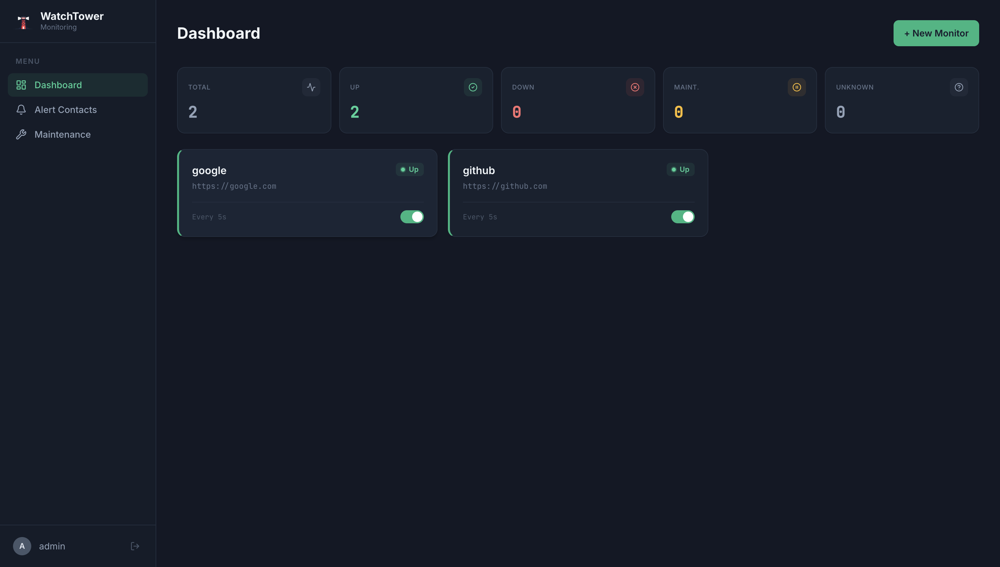
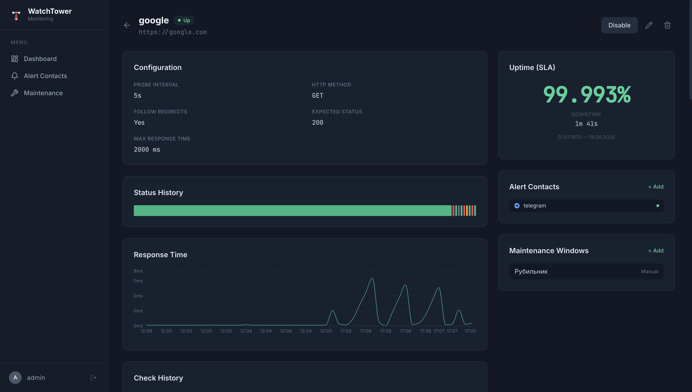

# WatchTower

WatchTower — self-hosted-система мониторинга доступности веб-ресурсов. Она регулярно проверяет HTTP-цели, оценивает результат по правилам пользователя, хранит историю состояний и SLA, а при изменении статуса отправляет уведомления в Telegram.

Этот документ содержит проектные материалы базовой WebLab № 1. Он описывает целевое поведение системы и отдельно отмечает ограничения текущей реализации.

## Цель

Владельцу сайта, API или внутреннего сервиса трудно постоянно проверять его доступность вручную и восстанавливать картину инцидента постфактум. WatchTower автоматизирует проверки, показывает текущее состояние и историю, рассчитывает SLA и сообщает об изменениях статуса.

Цель проекта — сократить время обнаружения недоступности ресурса и дать пользователю единое место для настройки проверок, плановых работ и каналов оповещения.

Ключевая особенность модели: Target описывает общую сетевую цель, а Monitor — пользовательские ожидания от этой цели. Несколько мониторов могут переиспользовать один Target и один сетевой запрос, но иметь разные интервалы, пороги и владельцев.

## Функциональные требования

- **FR-01. Учётные записи.** Гость может зарегистрироваться и войти; защищённые операции доступны только авторизованному пользователю.
- **FR-02. Управление мониторами.** Пользователь может создать, посмотреть, изменить, удалить, включить и отключить свой монитор.
- **FR-03. Настройка HTTP-проверки.** Пользователь задаёт URL, HTTP-метод, заголовки, тело запроса, допустимые коды ответа, максимальную задержку и интервал.
- **FR-04. Выполнение проверок.** Система планирует HTTP-запросы, сохраняет сырой результат и применяет ожидания каждого связанного монитора.
- **FR-05. Состояние монитора.** Система присваивает состояние UP, DOWN, MAINTENANCE или UNKNOWN и хранит интервальную историю его изменений.
- **FR-06. Метрики.** Пользователь может посмотреть последние проверки, задержку ответа, историю статусов и SLA своего монитора.
- **FR-07. Контакты.** Пользователь может управлять Telegram-контактами, включать их и связывать со своими мониторами.
- **FR-08. Окна обслуживания.** Пользователь может создавать разовые и ручные окна обслуживания и связывать их с мониторами.
- **FR-09. Уведомления.** При изменении состояния монитор передаётся сервису уведомлений, который отправляет новый статус по активным Telegram-контактам.
- **FR-10. Дедупликация целей.** Мониторы с одинаковыми endpoint, протоколом и сетевой конфигурацией переиспользуют один Target; частота его проверки выбирается по минимальному интервалу связанных мониторов.

Текущая версия выполняет только HTTP-проверки и отправляет уведомления только через Telegram. Типы TCP и ICMP присутствуют в модели, но их исполнители не завершены и не входят в готовую функциональность.

## Нефункциональные требования

Следующие значения — измеримые критерии приёмки проекта, а не результаты уже проведённых испытаний.

| Категория | Идентификатор | Критерий приёмки |
|---|---|---|
| Производительность | NFR-PERF-01 | При нагрузке 50 запросов/с в течение 10 минут p95 времени ответа операций чтения списка и карточки монитора не превышает 500 мс, а доля HTTP 5xx не превышает 1%. |
| Надёжность | NFR-REL-01 | После перезапуска backend загружает сохранённые активные цели и возобновляет их планирование не позднее чем через 10 секунд без потери конфигурации. |
| Безопасность | NFR-SEC-01 | 100% защищённых операций отклоняют запрос без корректного JWT; пароли хранятся только как bcrypt-хеши, а JWT secret, пароль БД, Telegram token и конфигурация контактов не попадают в ответы и логи. |

## Пользовательские сценарии

### UC-01. Создание HTTP-монитора

**Актор:** авторизованный пользователь.

**Предусловия:** пользователь вошёл в систему; проверяемый URL доступен из сети backend.

**Основной поток:**

1. Пользователь открывает форму нового монитора.
2. Вводит название, URL, HTTP-метод, интервал и ожидания ответа.
3. При необходимости выбирает созданные ранее Telegram-контакты.
4. Система проверяет обязательные поля и ограничения значений.
5. Система ищет Target с той же сигнатурой. Если он уже существует, Target переиспользуется; иначе создаётся новый.
6. Система создаёт Monitor и обновляет минимальный интервал проверки Target.
7. Новый монитор появляется на Dashboard.

**Альтернативы:**

- при неверном URL или интервале система возвращает ошибку валидации и ничего не создаёт;
- при сбое хранилища пользователь получает ошибку, а частично созданная конфигурация не считается успешным результатом.

**Результат:** у пользователя есть монитор, связанный ровно с одним Target и готовый к планированию проверок.

### UC-02. Разбор инцидента

**Акторы:** система мониторинга и авторизованный пользователь.

**Предусловия:** активный монитор уже создан; для него выполняются проверки; при необходимости подключён активный Telegram-контакт.

**Основной поток:**

1. Scheduler ставит Target в очередь по расписанию.
2. WorkerPool выполняет HTTP-запрос и сохраняет ProbeResult.
3. Analyzer применяет ожидания монитора и определяет состояние DOWN.
4. При изменении статуса Notification отправляет новый статус по активным Telegram-контактам.
5. Пользователь открывает карточку монитора.
6. Пользователь сопоставляет код ответа или сетевую ошибку, график задержки, историю статусов и SLA.

**Альтернативы:**

- если ожидания выполнены, монитор остаётся в UP и уведомление без изменения статуса не отправляется;
- если активно окно обслуживания, результат получает состояние MAINTENANCE и исключается из знаменателя SLA;
- если очередь уведомлений заполнена, состояние сохраняется, но отправка может быть отброшена с записью в лог.

**Результат:** пользователь видит причину и временной контекст инцидента; сохранённая история остаётся доступной после завершения сбоя.

### UC-03. Плановое обслуживание

**Актор:** авторизованный пользователь.

**Предусловия:** у пользователя есть хотя бы один монитор.

**Основной поток:**

1. Пользователь открывает раздел окон обслуживания.
2. Выбирает разовое окно с началом и окончанием либо ручное окно с переключаемым состоянием.
3. Заполняет название и описание, выбирает свои мониторы.
4. Система проверяет конфигурацию и сохраняет окно со связями.
5. Во время активного окна Analyzer назначает связанному монитору состояние MAINTENANCE.
6. После окончания разового окна или выключения ручного окна результаты снова оцениваются как UP или DOWN.

**Альтернативы:**

- окончание разового окна раньше начала отклоняется как неверный интервал;
- отсутствующий монитор или недоступная пользователю связь отклоняются;
- окно без выбранных мониторов сохраняется как конфигурация, но не влияет на оценки.

**Результат:** плановые работы видны отдельно от аварийной недоступности и не уменьшают рассчитанный SLA.

## Диаграммы

Редактируемые исходники хранятся в PlantUML и DBML.

### Use Case

[Use Case: роли и возможности WatchTower](docs/puml/use-case.puml)

Диаграмма связывает гостя с регистрацией и входом, а авторизованного пользователя — с мониторами, контактами, обслуживанием, Dashboard, историей и SLA.

### BPMN

В проекте подготовлены три нелинейных процесса:

1. [Создание нового монитора](docs/puml/bpmn/bpmn-new-monitor.puml) — валидация, дедупликация Target и выбор минимального интервала.
2. [Проверка ресурса и оповещение](docs/puml/bpmn/bpmn-target-check.puml) — HTTP-проверка, окно обслуживания, оценка ожиданий и уведомление при смене статуса.
3. [Создание и применение окна обслуживания](docs/puml/bpmn/bpmn-maintenance-window.puml) — тип окна, проверка конфигурации, привязка мониторов и влияние на оценку.

### Модель предметной области и база данных

- [ER-диаграмма сущностей](docs/puml/er-diagram.puml)
- [Диаграмма базы данных в DBML](docs/db.dbml)

Главные связи:

- User владеет Monitor, AlertContact и MaintenanceWindow;
- Monitor ссылается на общий Target;
- Target имеет много ProbeResult;
- Monitor имеет интервальную историю MonitorStatusLog;
- Monitor связан отношениями многие-ко-многим с контактами и окнами обслуживания.

В PostgreSQL отдельной таблицы ProbeSummary нет: сводка строится из сырых результатов и истории статусов. MongoDB-адаптер хранит сводки отдельными документами.

### Архитектура C4

- [C4 Level 1 — системный контекст](docs/puml/c4/l1.puml)
- [C4 Level 2 — контейнеры](docs/puml/c4/l2.puml)
- [C4 Level 3 — компоненты backend](docs/puml/c4/l3.puml)

WatchTower развёртывается как React SPA, Go backend, PostgreSQL и Redis. Backend взаимодействует с HTTP-ресурсами и Telegram Bot API.

## Технологический стек

| Область | Технологии |
|---|---|
| Backend | Go 1.26, Gin, oapi-codegen |
| Доступ к данным | pgx, sqlc, MongoDB driver |
| Миграции | Goose |
| Фоновые события | Watermill GoChannel |
| Основное хранилище | PostgreSQL |
| Кэш последних сводок | Redis |
| Frontend | React 19, TypeScript, React Router |
| HTTP-клиент и визуализация | Axios, Recharts |
| Стили | Tailwind CSS |
| Доставка приложения | Docker, Docker Compose |

HTTP API, Scheduler, Analyzer и Notification работают в одном backend-процессе. React SPA запускается отдельно. Watermill GoChannel передаёт события только в памяти; Redis не служит брокером сообщений или основным хранилищем.

## Экраны будущего веб-приложения

В проекте уже есть реализованный интерфейс, поэтому его экраны переиспользуются как уточнённые эскизы распределения функций.

### Dashboard

Экран показывает количество мониторов по состояниям, карточки целей, интервал и переключатель активности. Отсюда пользователь создаёт монитор и переходит к контактам или окнам обслуживания.

### Карточка монитора

Экран объединяет конфигурацию, SLA, историю состояний, график задержки, проверки, контакты и окна обслуживания. Действия изменения, удаления и отключения расположены рядом с заголовком.

## Архитектурные решения

### ADR-001. Модульный монолит

**Контекст.** Системе нужны HTTP API и три фоновых контура: планирование проверок, анализ результатов и отправка уведомлений. Учебный проект должен запускаться локально одной командой и при этом сохранять понятные границы модулей.

**Решение.** Размещать API и фоновые службы в одном Go-процессе, разделяя домен, сервисы, порты репозиториев и инфраструктурные адаптеры.

**Альтернативы.** Набор независимо развёртываемых микросервисов; монолит без модульных интерфейсов.

**Последствия.** Развёртывание и локальная отладка проще, нет сетевых отказов между внутренними службами. Масштабирование отдельных контуров и изоляция их отказов ограничены; выделение сервисов потребует явных внешних контрактов.

### ADR-002. PostgreSQL как источник истины, Redis как кэш

**Контекст.** Конфигурация и история требуют устойчивого хранения и связей, а Dashboard часто запрашивает последние сводки.

**Решение.** Хранить пользователей, мониторы, цели, сырые результаты и историю состояний в PostgreSQL. Redis использовать как необязательный кэш последних ProbeSummary с ограниченным размером и TTL.

**Альтернативы.** Только PostgreSQL без кэша; MongoDB как единственное основное хранилище; хранение текущего состояния только в Redis.

**Последствия.** Потеря Redis не уничтожает основные данные, а чтение недавних сводок ускоряется при прогретом кэше. Появляются правила инвалидирования и два эксплуатационных компонента. MongoDB-адаптеры сохраняются как альтернативная реализация, но текущий Compose-сценарий опирается на PostgreSQL.

## Запуск

### Полный стек

~~~bash
docker compose up --build
~~~

После запуска:

- UI: http://localhost:3000
- API: http://localhost:8080
- Swagger UI: http://localhost:8080/swagger
- OpenAPI: http://localhost:8080/openapi.yaml

### Backend локально

При доступных PostgreSQL и Redis:

~~~bash
go run ./cmd/api configs/config.yaml
~~~

### Frontend локально

~~~bash
cd watchtower-ui
npm install --legacy-peer-deps
npm start
~~~

## Ограничения текущей реализации

- TCP- и ICMP-prober пока содержат незавершённые реализации; рабочим считается HTTP.
- Зарегистрирован только Telegram-провайдер уведомлений.
- События Watermill GoChannel непостоянны и могут быть потеряны при остановке процесса.
- MongoDB не входит в Docker Compose, а миграции PostgreSQL выполняются при запуске приложения.
- Окно обслуживания влияет на оценку статуса и SLA, но отдельного подавления событий уведомлений для переходов в MAINTENANCE и из него сейчас нет.
- Проверку владельца в операциях связывания окон обслуживания и контактов с мониторами требуется отдельно подтвердить и при необходимости усилить до выполнения NFR-SEC-01.
